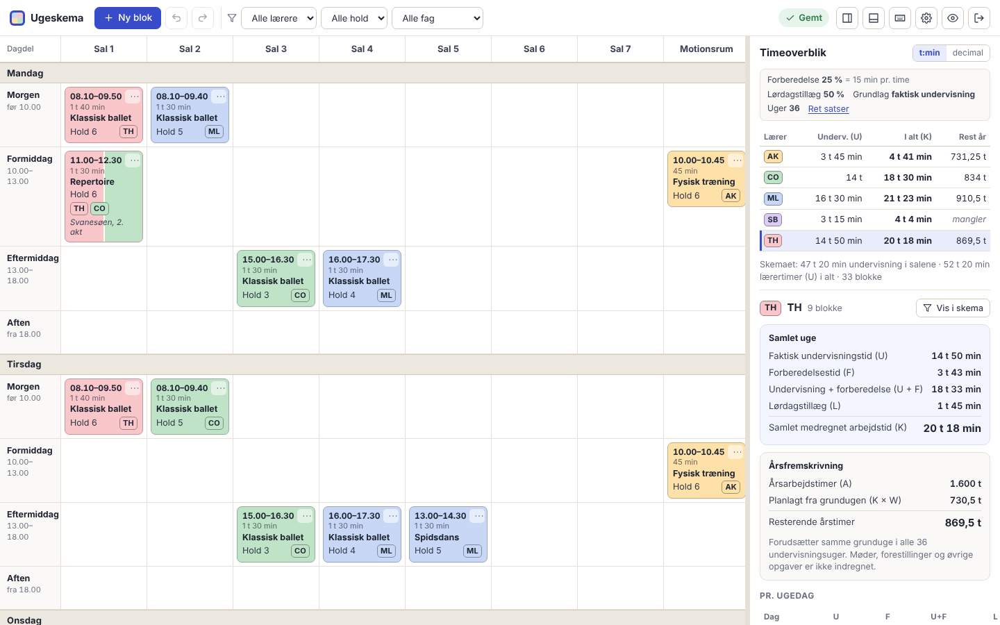

# Ugeskema – balletskole

Webapp til at planlægge skolens faste undervisningsuge (mandag–lørdag) i otte rum og samtidig
følge hver lærers undervisningstid, forberedelse, lørdagstillæg og resterende årstimer.

- **Redigering** (administrator): `/admin`
- **Læsevisning** (kun skemaet, opdateres automatisk): `/`

Krav og beregningsregler står i [SPEC.md](SPEC.md). Status står i [WORK_STATUS.md](WORK_STATUS.md).



## Kom i gang lokalt

Kræver Node.js 22 eller nyere.

```bash
npm install
```

```bash
npm run dev
```

Åbn http://localhost:5173/admin. Uden `ADMIN_PASSWORD` bruger udviklingsserveren adgangskoden
`admin` (kun uden for produktion). Databasen ligger i `data/ugeskema.sqlite`.

Et tomt skema kan fyldes med eksempeldata under **Indstillinger → Data og backup**. Det er kun
muligt, når skemaet er helt tomt, så rigtige data aldrig overskrives.

### Produktion på egen maskine

```bash
npm run build
```

```bash
ADMIN_PASSWORD='et-langt-kodeord' npm start
```

Appen kører derefter på http://localhost:3000.

### Prøveversion uden server

```bash
npm run build:standalone
```

Bygger `dist/standalone/ugeskema-proeve.html`: én fil, hvor serveren er erstattet af en udgave,
der kører i browseren (samme validering og beregning). Data gemmes kun i den enkelte browser, og
download af backup er slået fra. Bruges til at prøve appen uden hosting – ikke til rigtig drift.

### Demotilstand

```bash
DEMO_MODE=1 ADMIN_PASSWORD='demo-kodeord' npm start
```

Demotilstand bruger en separat databasefil (`data/demo.sqlite`), starter med eksempeldata og
viser et tydeligt **DEMOTILSTAND**-mærke. Produktionsdatabasen berøres ikke.

## Konfiguration (miljøvariabler)

| Variabel | Standard | Betydning |
|---|---|---|
| `ADMIN_PASSWORD` | – (kræves i produktion, min. 8 tegn) | Adgangskode til redigering |
| `VIEWER_PASSWORD` | tom | Hvis sat, kræver læsevisningen denne adgangskode. Tom = læsevisningen er åben for alle med linket |
| `PORT` | `3000` | HTTP-port |
| `DATA_DIR` | `./data` | Mappe til databasen |
| `DB_FILE` | `DATA_DIR/ugeskema.sqlite` | Præcis databasefil (overstyrer `DATA_DIR`) |
| `DEMO_MODE` | – | `1` = demotilstand med egen database |
| `SESSION_SECRET` | genereres og gemmes i databasen | Nøgle til at signere login-cookies |
| `COOKIE_SECURE` | `true` i produktion | Kræv HTTPS for login-cookien. Sæt `false` kun ved ren http på et lokalnet |
| `TRUST_PROXY` | `false` | Sæt `true` bag en HTTPS-proxy/hostingplatform (ellers ser login-spærringen alle brugere som samme IP) |
| `BACKUP_DIR` | `<databasemappe>/backups` | Mappe til den daglige kopi af databasen. `off` slår det fra |
| `BACKUP_KEEP` | `14` | Antal daglige kopier, der beholdes |

## Brug

Hovedskærmen har kun skemaet, timeoptællingen, **Tilføj ny klasse** og tandhjulet.

1. **Tilføj ny klasse**: vælg hold (ét eller flere), lærer(e) og evt. titel (standard
   "Balletklasse"). Tryk **Opret og placér**, og tryk derefter på en celle eller træk kortet derhen.
   Du kan også trykke direkte på en tom celle.
2. **Tiden kommer automatisk**, også når du flytter klassen til et sted, den ikke har været før:
   holdets tid den dag i skemadokumentet, ellers holdets tid i samme dagdel en anden dag, ellers
   dagdelens standardtid. Standardtiderne kan rettes under tandhjulet.
3. **Flyt** en klasse ved at trække den (på iPad: hold fingeren et øjeblik). Under træk viser den
   løftede klasse den tid, den får i cellen. Alt+træk kopierer. Tryk på en klasse for at redigere,
   flytte, kopiere eller slette den.
4. **Retter du tidspunktet** på en klasse, bliver den en "anden slags" blok med egne tider
   (låsesymbol), som bevarer præcis sit klokkeslæt, uanset hvor den flyttes. Den kan sættes tilbage
   til automatisk tid i redigeringen.
5. **Timer pr. uge** til højre: tryk på en lærer for undervisning, forberedelse, lørdage og
   timebank. Beregningen følger skolens timeopgørelse (25 min forberedelse pr. time, lørdage
   × 1,25 fordelt på 18 lørdage og 41 uger, kontrakt minus 1 t orientering = timebank).
6. **Spørgsmål**: en prik på tandhjulet betyder, at der er spørgsmål eller manglende oplysninger
   (fx kontrakttimer). Tryk på et svar – det bruges straks og kan fortrydes.
7. **Tandhjulet** samler alt andet: lærere og hold, tidsregler og morgensamling, satser og
   årsarbejdstid med detaljeret opgørelse, fortryd/gentag, konflikter, backup og læsevisning.
8. **Fortryd**: Ctrl/⌘+Z, Gentag: Ctrl/⌘+Shift+Z – eller "Fortryd" i beskeden efter en ændring.

### Tidstabellen fra skemadokumentet

Tiderne er udtrukket fra `Balletskole_Skema_26_27_Master_fra_uge_43.xlsx`, arket **KDS**. Hele
tabellen med cellehenvisninger står i [docs/tidstabel-kds.md](docs/tidstabel-kds.md). Ændres
dokumentet, kan udtrækket genskabes:

```bash
python3 -I scripts/extract_schedule.py Balletskole_Skema_26_27_Master_fra_uge_43.xlsx "KDS " shared/source/kds.ts
```

```bash
npx tsx scripts/print-rules.ts
```

Kræver Python med `openpyxl`. I appen kan tidstabellen derefter genindlæses under
Indstillinger → Tidsregler og morgensamling → Kilde.

## Online drift

Appen er klar til drift som én Node-proces med en SQLite-fil på en **vedvarende disk**.
Hostingvalget kræver en konto, som ikke er oprettet endnu.

**Docker / docker compose** (fx på en VPS):

```bash
ADMIN_PASSWORD='et-langt-kodeord' docker compose up -d --build
```

Databasen ligger i volumen `ugeskema-data` (`/data` i containeren). Sæt en HTTPS-proxy (fx Caddy
eller nginx) foran og `TRUST_PROXY=true`.

**Render**: `render.yaml` beskriver en Docker-webservice med 1 GB vedvarende disk på `/data`.
Opret en Blueprint fra repoet og udfyld `ADMIN_PASSWORD` (og evt. `VIEWER_PASSWORD`).
Persistente diske kræver en betalt instans. Andre platforme med vedvarende volumen (Fly.io,
Railway m.fl.) kan bruge samme `Dockerfile` med en volumen monteret på `/data`.

Vigtigt ved drift:

- Kør **én** instans (SQLite-filen må ikke deles mellem flere servere).
- Serveren tager selv en daglig kopi af databasen i `/data/backups` (14 dage) og gemmer de
  seneste 500 versioner, som kan gendannes fra appen. Kopierne ligger på samme disk, så tag også
  jævnligt en ekstern backup (*Download backup* eller en kopi af `/data`).
- Brug HTTPS. Login-cookien er `HttpOnly`, `SameSite=Strict` og `Secure` i produktion. Skiftes
  `ADMIN_PASSWORD`, logges alle administratorer automatisk ud.
- Serveren sender sikkerhedsheadere (CSP, X-Frame-Options m.fl.), spærrer login efter 20
  forkerte forsøg pr. IP på 10 minutter og kontrollerer databasens integritet ved opstart.

## Tests

```bash
npm test
```

Kører enhedstests (beregning, tidsregler, kildeudtræk, morgensamling, migrering, konflikter,
validering) og API-tests (adgang, versionskontrol, validering, persistens, migrering ved opstart,
import, demobeskyttelse, sikkerhed).

```bash
npm run test:e2e
```

Kører browsertests med Playwright mod den byggede app (kræver `npm run build` først og en
installeret Chromium) af SPEC.md's kontrolpunkter: hovedskærm, oprettelse, automatiske tider,
fredag/lørdag, morgensamling, egne tider, fælles klasser, manglende regler, konflikter, ændrede
tidsregler, fortryd, genindlæsning, lagringsfejl, forældet vindue, læseadgang og iPad med touch.

```bash
npm run test:all
```

Typekontrol, enhedstests, build og browsertests i ét.

## Arkitektur

```
shared/   Datamodel (zod), validering, beregning (calc.ts), tidsregler (rules.ts), konflikter,
          migrering, kildedata (source/) – bruges af både klient og server
server/   Express 5 + better-sqlite3: adgang, versioneret lagring, eksport/import
client/   React 19 + Vite + @dnd-kit: skema, redigering, timepanel, indstillinger, læsevisning
tests/    unit/ og api/ (Vitest), e2e/ (Playwright)
```

- Hele appens data er ét JSON-dokument med versionsnummer i SQLite. Hver gemning sender
  `baseVersion`; serveren afviser forældede versioner (HTTP 409) og validerer hele dokumentet med
  samme regler som klienten.
- Beregninger findes ét sted (`shared/calc.ts`) og bruges til alle visninger og årstal.
- Fortryd er snapshots af dokumentet i klienten; hver brugerhandling er ét trin.
